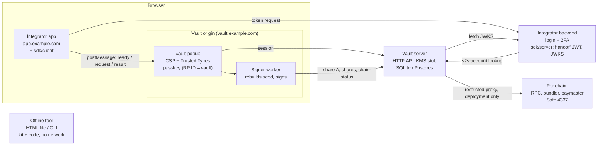

# WL Embedded Wallet

WL Embedded Wallet is an open-source, embedded, **non-custodial** wallet built on Tether's [Wallet Development Kit (WDK)](https://docs.wdk.tether.io/). Applications offer their users a smart-account wallet without ever holding their keys: the BIP-39 seed is split 2-of-3 with Shamir secret sharing, **any two shares rebuild it, and only ever in the user's browser**, inside an isolated vault origin. The user's account is a Safe 4337 smart account with the **same address on every EVM chain**.

> [!WARNING]
> Version **0.1.0** is the initial release, prepared for an external security audit. It has **not** been audited and is **not ready to hold real funds**. See [Project status](#project-status).

## How it works

| Share | Where it lives | How it is unlocked |
|---|---|---|
| **A** | Vault server, sealed with the server's master key (`MASTER_KEY`, a KMS stand-in) | A vault session, opened with a short-lived token signed by the integrator's backend |
| **B** | Vault server and the user's Emergency Kit | The user's passkey: WebAuthn PRF output, HKDF-SHA256, AES-256-GCM |
| **C** | Vault server and the user's Emergency Kit | The user's recovery code (128 bits): Argon2id, AES-256-GCM |

- `@tetherto/wdk-utils` performs the Shamir split and combine in the browser; `@tetherto/wdk-wallet-evm-erc-4337` cross-checks the Safe address on the server (read-only).
- A **manifest** signed by the vault (Ed25519) binds each set: the SHA-256 of every share, the owner address, the Safe parameters. Everything is verified before the seed is used.
- The **Emergency Kit** (a JSON file) carries the encrypted shares B and C, the signed manifest and, by default, a **backup of the seed encrypted with the recovery code**. The backup never reaches the server.
- An **offline recovery tool** (a single HTML file and a Node CLI, no network, reproducible build with a published SHA-256) and a **static recovery page** keep the wallet usable if the service disappears.

> [!IMPORTANT]
> **The kit plus the recovery code are enough to obtain the seed**, with no passkey and no server. That is what keeps the wallet alive if the backend disappears for good, and it is why **the kit and the code must be stored separately**.

## Architecture



- The **integrator app** never sees a share, the PRF output, the recovery code or the seed. It receives addresses and signatures.
- The **vault popup** runs on its own origin with a strict, nonce-based CSP and Trusted Types. It shows what is being signed before the passkey is used.
- The **signer worker** decrypts, verifies, combines and signs, then discards the seed. One worker per operation.
- The **vault server** stores share A (sealed), the encrypted B and C, and the signed manifests; it builds the Safe's deployment itself, within its gas and fee caps, and sends only that operation, signed by the owner, to the bundler and paymaster, so their URLs and keys never reach the browser.

Details, trust boundaries and per-operation data flows: [docs/ARCHITECTURE.md](docs/ARCHITECTURE.md).

### Repository layout

| Path | Package | What it is |
|---|---|---|
| `packages/core` | `@wl-embedded-wallet/core` | Pure cryptographic core: envelopes, PRF, recovery code, Argon2id, seed backup, manifest, Shamir wrappers, kit, Safe, sign-request validation, relink, the worker's request handler. No React, Next.js, network or storage. **Main audit target.** |
| `packages/sdk` | `@wl-embedded-wallet/sdk` | `/client` for browsers, `/server` for Node backends (handoff tokens, JWKS, s2s client, signature verification), `/protocol` (wire types shared with the vault) |
| `packages/recovery-tool` | `@wl-embedded-wallet/recovery-tool` | Offline HTML tool and Node CLI, built reproducibly with esbuild over the core |
| `apps/vault` | `@wl-embedded-wallet/vault` | The vault service (Next.js): popup UI, HTTP API, SQLite and Postgres stores, KMS stub, signer worker, static recovery page builder, Dockerfile |
| `examples/demo` | `@wl-embedded-wallet/demo` | The public demo: a sample integrator app using only the public SDK, in the project's own brand (`brands/wl`). Register and log in with TOTP 2FA (QR code), activate, deploy, sign, verify, relink |
| `e2e` | `@wl-embedded-wallet/e2e` | Playwright end-to-end suites |
| `apps/vault/tests/aa-stack` | | Real Safe and EntryPoint contracts on anvil, with a local bundler and paymaster |
| `brands/wl` | | The project's own brand ("WL Embedded Wallet"): used by the demo and, in development, by the vault |
| `brands/example` | | Example brand for a fictional "Acme Wallet", mounted by the e2e suites |
| `deploy/` | | Example Caddy configurations |

All workspace packages are `private`: nothing is published to a registry.

## Quickstart (local development)

Requirements: Node.js 22.13 or later, pnpm 10, [Foundry](https://getfoundry.sh/) (`anvil`) for the local chains, and Chrome or Chromium. Docker only for the Postgres and image test suites and for deployment. `*.localhost` names resolve natively in Chromium; elsewhere add `127.0.0.1 app.localhost vault.localhost` to `/etc/hosts`.

```bash
pnpm install
pnpm setup:env      # writes apps/vault/.env.local and examples/demo/.env.local with fresh, consistent keys
pnpm aa:stack       # terminal 1: local chains with the real Safe and EntryPoint contracts
pnpm dev            # terminal 2: the vault and the demo
```

| Service | Address |
|---|---|
| Demo app | <http://app.localhost:3200> |
| Vault | <http://vault.localhost:3201> |
| Local chains (`pnpm aa:stack`) | RPC on `21545`, `21546`, `21547`; bundler on the RPC port + 1000; paymaster on the RPC port + 2000 (the third chain has no contracts, bundler or paymaster) |

`pnpm dev` does not apply the vault's CSP, because Next.js needs `eval` in development. To check it, run the production build: `pnpm --filter ./apps/vault build && pnpm --filter ./apps/vault start`. In development the vault uses the project's brand (`VAULT_BRAND_DIR=../../brands/wl`); without that variable it uses the neutral brand. The e2e suites mount `brands/example` themselves.

### Using the demo

1. **Register** with an email and a password, and scan the QR code with an authenticator app (this is the app's own 2FA).
2. **Activate the wallet.** The vault popup creates a passkey, shows the recovery code once and asks for two of its groups, then has you download the recovery tool and then the kit, and runs an A+B drill before the wallet counts as active.
3. **Pick a network.** The address is the same on all of them.
4. **Deploy the Safe** on that network (sponsored by the local paymaster). Signing is blocked on a network until then.
5. **Sign** a message, EIP-712 data or a UserOperation: review it in the popup and approve with the passkey. The demo's server verifies the signature. Nothing but the deployment is sent to the chain.
6. **Recover:** "Test unlock" runs A+B, and offers a new kit if yours is an old one. "I lost my passkey" uses A+C and creates a new set for the same Safe; with the kit you can sign and download the seed without the API; without the kit, use the passkey and the code.
7. **Export the seed** if you want (optional, with confirmation and the passkey).
8. **Without the service:** open `wl-embedded-wallet-recovery.html` offline with the kit and the code, or run `node packages/recovery-tool/dist/wl-embedded-wallet-recovery.mjs kit.json`.
9. **Lost the app login:** create another account and choose "I already have a wallet": you sign with your key and the wallet moves to that account; the old one loses access.

## Docker quickstart

The vault ships as a configuration-free image; each deployment brings its own Postgres, domain and keys. From the repository root:

```bash
docker build -f apps/vault/Dockerfile -t wl-embedded-wallet-vault:local .
docker run --rm wl-embedded-wallet-vault:local node scripts/generate-secrets.mjs > .env
# edit .env: ORIGIN, RP_ID, HANDOFF_JWKS_URL (or HANDOFF_PUBLIC_KEY), HANDOFF_ISSUER, ... (see .env.example)
docker compose up -d --wait                    # vault + Postgres (Compose project "wl-embedded-wallet")
docker compose --profile tls up -d --wait      # optionally with Caddy terminating TLS for VAULT_DOMAIN
```

`generate-secrets.mjs` writes the vault's secrets to stdout and, on stderr, material for your app's backend. Choose the final domain before the first user enrolls: passkeys are bound to `RP_ID`. Every environment variable, TLS, the static recovery page, migrations and backups: [docs/DEPLOYMENT.md](docs/DEPLOYMENT.md).

The vault and the demo can also run on Vercel with Neon ([docs/DEPLOYMENT.md](docs/DEPLOYMENT.md#deploy-to-vercel-and-neon)). The public demo deployed that way is a **testnet demo bound to its `*.vercel.app` host**: its passkeys cannot move to another domain, so its wallets may be lost. Do not use it for real funds.

## Integrating the SDK

**Browser** (`@wl-embedded-wallet/sdk/client`): call each method directly from a click handler, so the popup is not blocked.

```ts
import { createVaultClient, VaultError, type VaultChain } from '@wl-embedded-wallet/sdk/client';

const vault = createVaultClient({
  vaultOrigin: 'https://vault.example.com',
  // Called every time the popup is ready. Send only the chain id: your server picks the RPC.
  getToken: async (chain?: VaultChain) => {
    const response = await fetch('/api/vault/token', {
      method: 'POST',
      headers: { 'Content-Type': 'application/json' },
      body: JSON.stringify(chain ? { chainId: chain.chainId } : {}),
    });
    return ((await response.json()) as { token: string }).token;
  },
});

button.onclick = async () => {
  try {
    const { address } = await vault.activate();          // the Safe address, same on every chain
    // later: vault.deploy(chain), vault.signMessage(chain, 'Sign in to Example App'), vault.recover(), ...
  } catch (error) {
    if (error instanceof VaultError) console.warn(error.code); // POPUP_BLOCKED, POPUP_CLOSED, USER_REJECTED, ...
  }
};
```

**Server** (`@wl-embedded-wallet/sdk/server`): mint the short-lived handoff token for an authenticated user and publish your public key as a JWKS that the vault fetches.

```ts
import { createHandoffToken, handoffPublicJwk } from '@wl-embedded-wallet/sdk/server';

// POST /api/vault/token, only for a session that completed your login and 2FA.
export function mintVaultToken(user: { id: string; email: string }, chain?: { chainId: number; rpcUrl?: string }) {
  return createHandoffToken(
    { sub: user.id, label: user.email, iss: 'https://login.example.com', aud: 'https://vault.example.com',
      origin: 'https://app.example.com', kid: 'handoff-1', ...(chain ? { chain } : {}) },
    process.env.VAULT_HANDOFF_PRIVATE_KEY!, // Ed25519 private key, hex; never on the vault or in a browser
  );
}

// GET /.well-known/jwks.json
export const jwks = () => Response.json({ keys: [handoffPublicJwk(process.env.VAULT_HANDOFF_PRIVATE_KEY!, 'handoff-1')] });
```

The vault is configured with `HANDOFF_ISSUER` and `HANDOFF_JWKS_URL` to accept these tokens (EdDSA, ES256 or RS256). The SDK also provides ES256 and RS256 signers, a server-to-server account client (`createVaultServiceClient`) and helpers to verify the signatures the vault returns (ERC-1271 and Safe UserOperations). Full guide and API reference: [docs/INTEGRATION.md](docs/INTEGRATION.md).

## Branding

The vault's look is neutral by default. Each deployment can mount a `brand.json` directory at runtime (`VAULT_BRAND_DIR`), with no rebuild: name, colors, corner radius, self-hosted fonts, logo, favicon, and support and legal links. Brands are validated at startup (contrast, accent hue kept apart from warning and error colors, safe SVG, size limits) and **cannot change flows or security notices**. The offline tool is never branded, so its hash is the same for every deployment. Examples: [`brands/wl`](brands/wl) (the project's own brand) and [`brands/example`](brands/example) (the fictional "Acme Wallet"). Reference: [docs/BRANDING.md](docs/BRANDING.md).

## Tests

```bash
pnpm typecheck
pnpm test               # unit tests of every package (SQLite)
pnpm test:pg            # vault store and API contract, then the demo's database, against Postgres in Docker
pnpm test:aa            # real Safe and EntryPoint contracts on anvil
pnpm --filter ./e2e exec playwright install chromium
pnpm test:e2e           # Chromium with a virtual passkey, the vault's production build, the demo
pnpm test:e2e:pg        # the same suite with the vault on Postgres
pnpm test:e2e:image     # the same suite with the vault inside the real Docker image
```

What each suite covers and the ports it needs: [docs/TESTING.md](docs/TESTING.md). What is and is not tested: [docs/TEST-STATUS.md](docs/TEST-STATUS.md).

## Project status

**0.1.0, pre-audit**, plus the unreleased pre-audit fixes in [CHANGELOG.md](CHANGELOG.md#unreleased). The cryptographic design, the vault, the SDK, recovery and deployment are complete for review and covered by unit, integration and end-to-end tests. Before production use, at least these gaps must be closed:

- **No real KMS.** `MASTER_KEY` lives in the server environment and a stub seals share A; share A reaches the server in plaintext over TLS at enrollment.
- **Rate limits and sponsorship caps untuned.** The vault limits its routes per IP and per user, caps request bodies, sends HSTS and bounds each sponsored deployment, but the defaults have not been tested under real load, behind a real proxy or on L2s. Per-IP limits need `TRUSTED_PROXIES` set to your proxy, or `CLIENT_IP_SOURCE=vercel` on Vercel ([docs/DEPLOYMENT.md](docs/DEPLOYMENT.md#rate-limits)).
- **Untested with real passkeys** (platform authenticators and their PRF support), Safari, Firefox and mobile browsers. Only Chromium with a virtual authenticator is tested.
- **Untested against public networks** and real bundlers or paymasters; only local chains have been used.
- **Single-region, single-database** design; backup restore untested; the `linux/amd64` image untested.
- **Accepted risks** by design, including: kit plus code equals the wallet; a stolen live handoff token yields that user's share A; whoever holds the seed can relink the wallet to another app account without notice to the owner; rotation does not change the seed.

The full list is in [docs/THREAT-MODEL.md](docs/THREAT-MODEL.md#accepted-risks) and the plan in [docs/ROADMAP.md](docs/ROADMAP.md).

## Documentation

| Document | Contents |
|---|---|
| [ARCHITECTURE.md](docs/ARCHITECTURE.md) | Components, layout, dependency direction, trust boundaries, data flows |
| [CRYPTO-SPEC.md](docs/CRYPTO-SPEC.md) | Every format and algorithm, with test vectors |
| [PROTOCOL.md](docs/PROTOCOL.md) | App-to-vault `postMessage` protocol, handoff token, JWKS, sessions |
| [HTTP-API.md](docs/HTTP-API.md) | Every vault HTTP route |
| [THREAT-MODEL.md](docs/THREAT-MODEL.md) | Assets, actors, mitigations, accepted risks |
| [AUDIT-SCOPE.md](docs/AUDIT-SCOPE.md) | Proposed audit scope and critical dependencies |
| [RECOVERY.md](docs/RECOVERY.md) | Every recovery path, step by step |
| [INTEGRATION.md](docs/INTEGRATION.md) | SDK guide and API reference |
| [DEPLOYMENT.md](docs/DEPLOYMENT.md) | Docker, Compose, Vercel and Neon, environment, TLS, public testnets, static recovery page, backups |
| [BRANDING.md](docs/BRANDING.md) | `brand.json` reference and validation |
| [DESIGN-SYSTEM.md](docs/DESIGN-SYSTEM.md) | Visual design rules of the vault UI |
| [TESTING.md](docs/TESTING.md) | Running the test suites |
| [TEST-STATUS.md](docs/TEST-STATUS.md) | What is tested and what is not |
| [REPRODUCIBLE-BUILDS.md](docs/REPRODUCIBLE-BUILDS.md) | Offline tool build, verification and published hash |
| [DECISIONS.md](docs/DECISIONS.md) | Design rationale |
| [ROADMAP.md](docs/ROADMAP.md) | Next phases |
| [SECURITY.md](SECURITY.md) | Reporting vulnerabilities |
| [CHANGELOG.md](CHANGELOG.md) | Release notes |

## License

[Apache License 2.0](LICENSE). Source code: <https://github.com/victormer/wl-embedded-wallet>.

## Trademarks

WDK is a trademark of Tether. WL Embedded Wallet is an independent project: it uses Tether's open-source WDK packages (`@tetherto/wdk-*`) as dependencies, and it is not affiliated with, endorsed by, sponsored by or operated by Tether.
