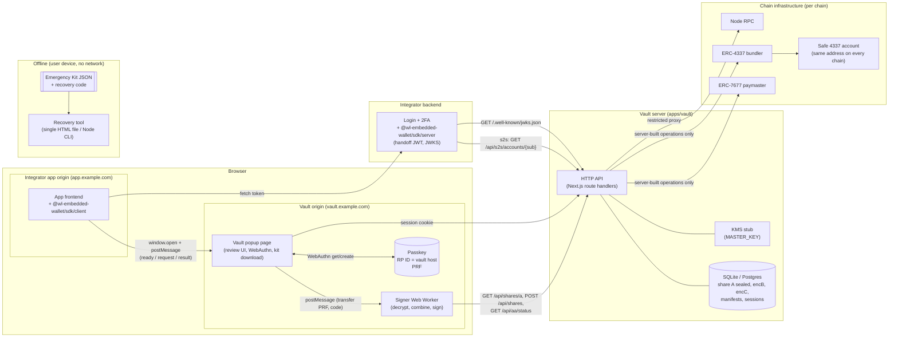
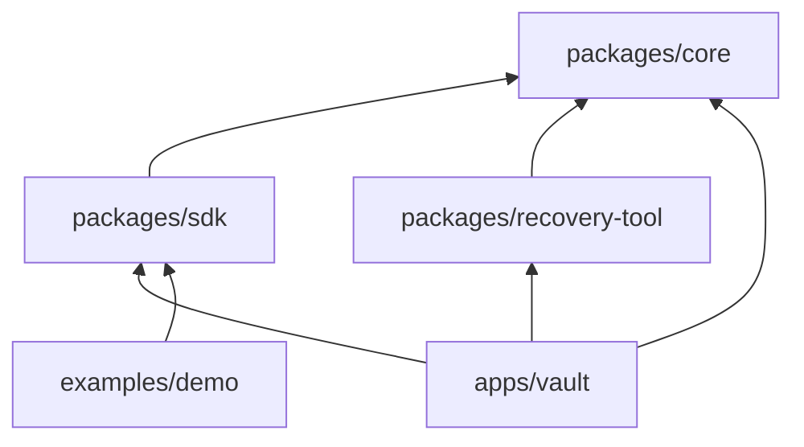
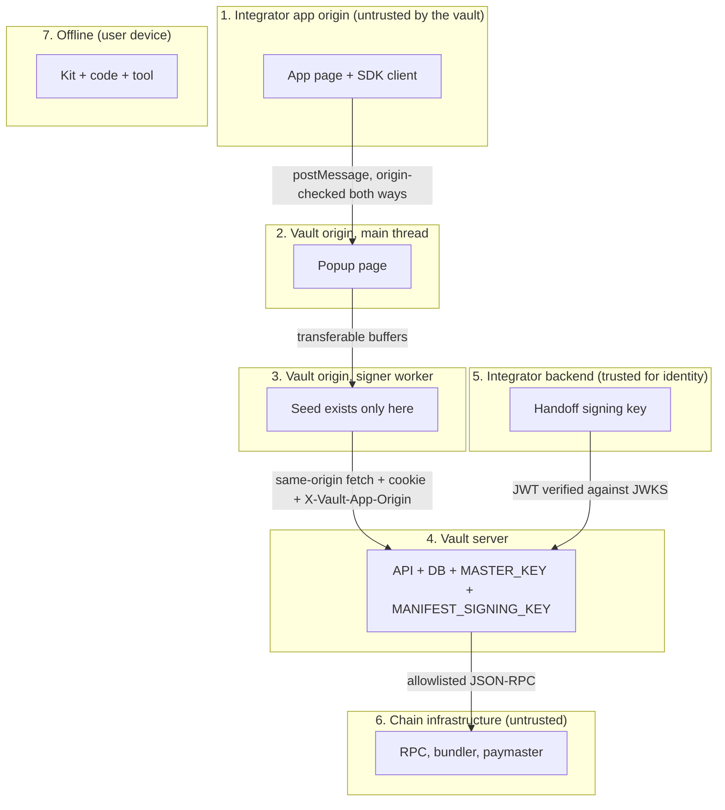
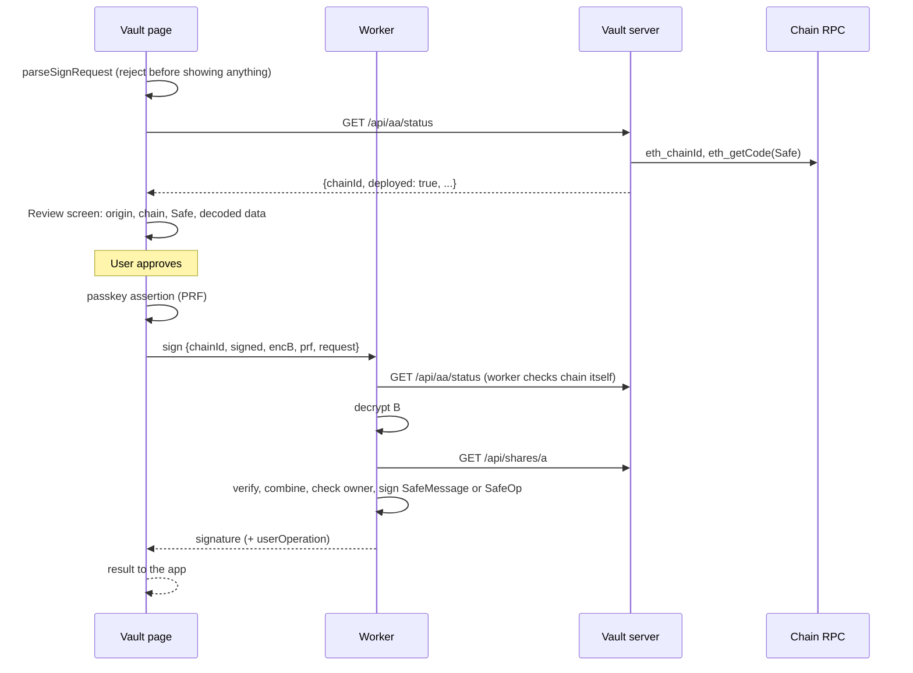
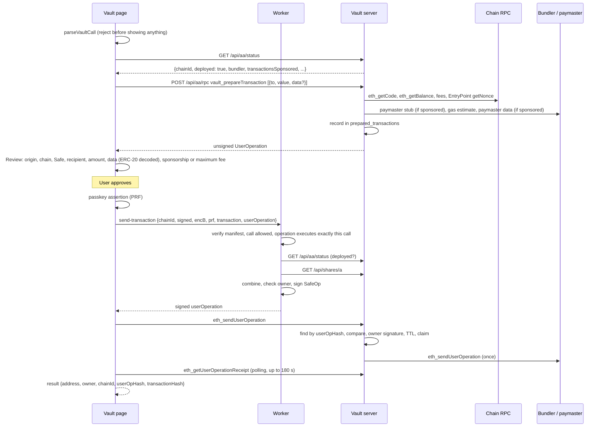

# Architecture

This document describes the components of WL Embedded Wallet 0.1.0, why the repository is laid out the way it is, where the trust boundaries are, and how data moves in every operation. Formats and algorithms are specified in [CRYPTO-SPEC.md](CRYPTO-SPEC.md); the app-to-vault protocol in [PROTOCOL.md](PROTOCOL.md); every HTTP route in [HTTP-API.md](HTTP-API.md); the security analysis in [THREAT-MODEL.md](THREAT-MODEL.md).

## Contents

- [System overview](#system-overview)
- [Who uses it](#who-uses-it)
- [Repository layout](#repository-layout)
- [Dependency direction](#dependency-direction)
- [Runtime components](#runtime-components)
- [Trust boundaries](#trust-boundaries)
- [Where secrets live](#where-secrets-live)
- [Server storage](#server-storage)
- [Data flows](#data-flows)
- [Design principles](#design-principles)

## System overview

WL Embedded Wallet is an embedded, non-custodial wallet that an application (the **integrator app**) can offer its users without ever holding their keys. It is built on Tether's Wallet Development Kit (WDK): `@tetherto/wdk-utils` performs the Shamir split and combine of the BIP-39 seed in the browser, and `@tetherto/wdk-wallet-evm-erc-4337` cross-checks Safe address prediction on the server.

The **vault** is a separate web service on its own origin. The integrator app opens it in a popup for every sensitive operation. The vault holds one share of each user's seed (share A) and the encrypted forms of the other two (B and C); the seed is rebuilt only in a Web Worker on the vault origin, for one operation, and discarded.



The JWKS arrow is drawn from the vault's perspective: the vault server fetches the integrator's JWKS to verify handoff tokens.

The same picture in plain text:

```
  Browser
  +---------------------------+  postMessage   +--------------------------------+
  | app.example.com           | -------------> | vault.example.com (popup)      |
  | App + sdk/client          | <------------- | Strict CSP, Trusted Types      |
  | Never sees shares or seed |  address,      | Passkey (RP ID = vault host)   |
  +-------------+-------------+  signature     | Worker: rebuild seed, sign     |
                |                              +---------------+----------------+
                | token                                        | session cookie
  +-------------v-------------+   JWKS, s2s    +---------------v----------------+
  | Integrator backend        | <------------> | Vault server (apps/vault)      |
  | Login + 2FA               |                | SQLite/Postgres, KMS stub      |
  | sdk/server: handoff JWT   |                | Proxy to bundler and paymaster |
  +---------------------------+                | (allowlist, server-built ops)  |
                                               +---------------+----------------+
                                                               |
                                               RPC / bundler / paymaster (per chain)

  Offline: Emergency Kit + recovery code -> recovery tool (HTML file or CLI), no network
```

## Who uses it

| Actor | What they do with the system |
|---|---|
| **End user** | Has an account in the integrator app. Reaches the vault only in a popup, for short, sensitive tasks: activate the wallet (passkey, recovery code, kit), deploy the Safe on a chain, review and approve a signature or a transaction, unlock, recover, link the wallet to another account, or export the seed. Their question is always "what am I approving, and what must I keep?" |
| **User without the service** | Opens the static recovery page or the offline tool with their kit and code because the backend is down or gone. |
| **Operator** | Deploys the vault image with their own Postgres, domain, keys and brand, configured entirely at runtime. |
| **Integrator** | Runs the app and its backend: authenticates users (with 2FA), mints handoff tokens, publishes a JWKS, embeds the SDK. |

## Repository layout

```
packages/core            @wl-embedded-wallet/core           Pure cryptographic core. Main audit target.
packages/sdk             @wl-embedded-wallet/sdk            /client (browser), /server (Node backend), /protocol (wire types)
packages/recovery-tool   @wl-embedded-wallet/recovery-tool  Offline HTML tool + Node CLI, reproducible esbuild build over core
apps/vault               @wl-embedded-wallet/vault          Next.js vault service: popup UI, HTTP API, stores, KMS stub,
                                                             signer worker, static recovery page builder, Dockerfile
examples/demo            @wl-embedded-wallet/demo           Neutral sample integrator app using only the public SDK
e2e                      @wl-embedded-wallet/e2e            Playwright end-to-end suites
apps/vault/tests/aa-stack                                    Real Safe + EntryPoint contracts on anvil, local bundler and paymaster
brands/example                                               Example brand ("Acme Wallet", fictional) for brand.json
deploy/                                                      Example Caddy configurations (TLS proxy, static recovery page)
scripts/                                                     setup-env.mjs (dev .env files), generate-secrets.mjs (production secrets)
```

All workspace packages are `private` and version `0.1.0`; nothing is published to a registry. Packages export TypeScript sources and are consumed through the pnpm workspace (`workspace:*`) with Next.js `transpilePackages`. See [INTEGRATION.md](INTEGRATION.md#2-packages-and-how-to-consume-them).

### Why this layout

- **`packages/core` is pure and small.** Everything that touches key material or defines a format (envelopes, PRF salt, recovery code, Argon2id, seed backup, manifest, Shamir wrappers, kit parsing, Safe prediction and signing, sign-request validation, relink typed data, and the worker's request handler `handleWorkerRequest`) lives in one package with no React, no Next.js, no network access and no storage. Its I/O (fetching share A, posting shares, reading chain status) is injected through the `SignerDeps` interface. This makes it testable in isolation, reusable by the vault, the static recovery page and the offline tool, and gives auditors one place to start ([AUDIT-SCOPE.md](AUDIT-SCOPE.md)).
- **`packages/sdk` is the only thing an integrator needs.** Its `/client` entry runs in the integrator's browser and knows nothing about keys; `/server` runs in the integrator's Node backend and mints tokens, serves the JWKS and verifies signatures; `/protocol` is the shared wire contract (`postMessage` message types and the protocol tag), imported by both the SDK and the vault so the two cannot drift.
- **`packages/recovery-tool` is separate** because its output must be byte-for-byte reproducible and identical for every deployment, independent of the vault's build, brand and configuration. Its published SHA-256 lets users check what they downloaded ([REPRODUCIBLE-BUILDS.md](REPRODUCIBLE-BUILDS.md)).
- **`apps/vault` is the only deployable service.** It contains everything that is specific to running the vault: the popup pages, the HTTP API, persistence, the KMS stub, the worker entry point, the brand loader and the static recovery page builder. Its image contains no configuration.
- **`examples/demo` uses only the public SDK** (`@wl-embedded-wallet/sdk/client` and `/server`), so it doubles as a test that the SDK is sufficient. It is a sample (register and log in with TOTP 2FA and a QR code, activate, deploy, sign, verify, send a transaction, relink), not part of the product, and is not in the vault image.
- **Separate hosts in development** (`app.localhost:3200` and `vault.localhost:3201`) rather than two ports on `localhost`, because two ports on one host share cookies and the RP ID, which would not exercise origin isolation.

## Dependency direction



| Package | Depends on (workspace) | Notes |
|---|---|---|
| `core` | none | Third-party: `@tetherto/wdk-utils`, `@noble/curves`, `@scure/bip39`, `hash-wasm`, `viem`, `abstractionkit` |
| `sdk` | `core` (`/operations` types, `/safe` helpers) | Plus `jose`, `@noble/curves`, `node:crypto` (server entry) |
| `recovery-tool` | `core` (`/offline`, `/errors`) | Build-time only: `esbuild` |
| `vault` | `core`, `sdk` (`/protocol`), `recovery-tool` (its `dist/` output, served at `/recovery-tool`) | Plus Next.js, React, `@simplewebauthn/server`, `pg`, `jose`, `@tetherto/wdk-wallet-evm-erc-4337` |
| `demo` | `sdk` only | Never imports `core` or vault code |

Nothing depends on `apps/vault` or `examples/demo`. The core never imports from any other workspace package.

## Runtime components

| Component | Where it runs | Code | Responsibility |
|---|---|---|---|
| SDK client | Integrator page | `packages/sdk/src/client` | Opens the popup from a user gesture, answers `ready` with a fresh token and the request, accepts one `result` from the exact vault origin and popup window |
| Integrator backend | Integrator server | `packages/sdk/src/server`, `examples/demo/server` | Authenticates the user, mints the handoff JWT (60 s, single use), publishes the JWKS, queries `/api/s2s/accounts/{sub}`, verifies returned signatures |
| Vault popup page | Vault origin, main thread | `apps/vault/app/*`, `apps/vault/lib/*` | Receives the request (`lib/vault-channel.ts`), redeems the token, shows review screens, runs WebAuthn (`lib/prf.ts`), generates and shows the recovery code, downloads the tool, the kit and the seed file, drives deployments and transactions through the proxy (`lib/aa-client.ts`) |
| Signer worker | Vault origin, dedicated Web Worker, one per operation | `apps/vault/lib/signer.worker.ts` over `packages/core/src/signer.ts` | Decrypts B and C, fetches share A, verifies the manifest and digests, combines, checks the address, signs; returns only results. Closes after one reply |
| Vault HTTP API | Vault server (Node.js) | `apps/vault/app/api/**/route.ts`, `apps/vault/server/*` | Token redemption and sessions, share storage and release, manifest signing, WebAuthn verification, relink, chain status and the restricted AA proxy (which builds the deployment and transaction operations, `server/sponsorship.ts` and `server/transactions.ts`), s2s lookup, brand files, tool download, health, rate limits (`server/rate-limit.ts`, `server/limits.ts`) |
| KMS stub | Vault server | `apps/vault/server/kms.ts` | Seals and opens share A with a key derived from `MASTER_KEY` |
| Store | Vault server | `apps/vault/server/store/*` | SQLite (`node:sqlite`, development and tests) or Postgres (`pg`), versioned migrations, atomic single-use operations, rate-limit counters shared by replicas |
| Static recovery page | Any static host on an origin valid for the RP ID | `apps/vault/static-recovery`, `apps/vault/scripts/build-static-recovery.mjs` | B+C and kit+code recovery with no backend (`connect-src 'none'`) |
| Offline tool | User device, `file://` or Node | `packages/recovery-tool` | Kit + code to seed, with owner and Safe checks, no network |
| Chain infrastructure | Third parties per chain | configured in `AA_CHAINS` | Node RPC, bundler, paymaster; reached only through the vault server |

## Trust boundaries



| # | Boundary | What crosses it | What protects it |
|---|---|---|---|
| 1 to 2 | App origin to vault origin | `ready`, `request` (token + action), `result` (address, signature) | Browser same-origin policy. SDK accepts messages only from the vault origin and its own popup; the vault accepts requests only from `window.opener` and answers only to the request origin, which must match the token's signed `origin`. No review screen and no `ok: true` result before the origin is verified. The app never receives shares, PRF output, code or seed. ([PROTOCOL.md](PROTOCOL.md#origin-checks)) |
| 2 to 3 | Vault page to worker | PRF output and code bytes (transferred, so detached from the page), encrypted envelopes, the signed manifest, the request | Same origin. The worker returns only an address, a signature, an encrypted seed backup or, for explicit exports, the mnemonic. The page never sees share plaintext. |
| 3 to 4 | Worker to vault server | Share A (plaintext, server to worker; and worker to server at enrollment), encB, encC, digests, chain status | TLS and HSTS, `__Host-vault_session` cookie (HttpOnly, Secure, SameSite=Strict, 15 min), `X-Vault-App-Origin` binding, `Origin` checks on writes, rate limits and a 128 KiB body cap. Share A of a `pending` set goes only to the session that created it, within per-session and per-user budgets, and every release is recorded. Share A is authenticated by the signed manifest's digest. |
| 5 to 4 | Integrator backend to vault server | Handoff JWT (via the browser), JWKS, s2s requests | JWT signature (EdDSA, ES256, RS256) against the JWKS, `iss`, `aud`, max 120 s lifetime, single-use `jti`, signed `origin`; s2s bearer token compared in constant time. **The vault trusts the integrator backend for user identity and cannot verify its 2FA.** |
| 4 to 6 | Vault server to chain infrastructure | Chain status calls, fee, gas and nonce queries, paymaster calls, the Safe deployment and transaction UserOperations | Four-method allowlist; the server builds every operation itself within the sponsorship caps, validates every fee, gas and paymaster answer, and forwards only an operation it prepared, with the owner's signature, once (a deployment once per Safe and chain); transactions are sponsored only where `AA_CHAINS[chainId].sponsorTransactions` is `true`; server-side sponsorship context; per-IP and per-`sub` rate limits; response size and time limits; chain id check. RPC providers, bundlers and paymasters are trusted only for liveness and the data they report. |
| 7 | Offline | Kit and code typed into the tool | CSP `connect-src 'none'` and a fetch stub; no server, no passkey. Authenticity rests on AES-GCM under the code; the tool does not verify the manifest signature. |

The vault page, the worker and the vault server are **one trust domain** in practice: whoever controls the JavaScript the vault origin serves controls everything a user does there. The boundaries 2 to 3 and 3 to 4 limit exposure inside that domain (no plaintext shares on the main thread; the server never sees B, C or the seed), they do not defend against a compromised vault server. See [THREAT-MODEL.md](THREAT-MODEL.md).

## Where secrets live

| Secret | At rest | In use | Never |
|---|---|---|---|
| Seed (mnemonic) | Nowhere in one piece; encrypted in the kit's seed backup; in plaintext only in an exported seed file the user chose to download | Worker, one operation; vault page only for `export` / `export-recovered` (to build the download) | Server, integrator app |
| Share A | Vault DB, sealed under `MASTER_KEY` | Worker, one operation | Kit, integrator app |
| Share B | Vault DB and kit, encrypted under the passkey PRF | Worker | Plaintext outside the worker |
| Share C | Vault DB and kit, encrypted under the code | Worker | Plaintext outside the worker |
| PRF output | Inside the authenticator (derived per call) | Vault page (briefly), transferred to the worker | Server, app |
| Recovery code | User's own storage (shown once) | Vault page input, transferred to the worker | Server, app, kit |
| `MASTER_KEY` | Vault server environment | Vault server | Anywhere else (no real KMS yet) |
| `MANIFEST_SIGNING_KEY` | Vault server environment | Vault server | Browser (only its public key is sent) |
| Handoff signing key | Integrator backend | Integrator backend | Vault, browser |
| `VAULT_SERVICE_TOKEN` | Vault environment and integrator backend | s2s calls | Browser |

The vault stores nothing in `localStorage`, `sessionStorage` or IndexedDB. Its only browser state is the session cookie.

## Server storage

Tables (migrations `001-initial` to `007-prepared-transactions` in `apps/vault/server/store/migrations/`):

| Table | Contents |
|---|---|
| `users` | `sub`, display `label` from the token, `exported_at` |
| `share_sets` | One row per set: `user_id`, `set_id`, status (`pending`, `active`, `revoked`), `credential_id`, manifest, signature, sealed `enc_a`, `enc_b`, `enc_c`, owner address (lowercase), passkey public key and counter when registered, and `created_session_hash` (SHA-256 of the session token that created it; `NULL` for sets created before migration 006). A partial unique index allows at most one `active` set per user. Revoked sets keep their manifest but their envelopes are set to `NULL`. |
| `sessions` | Session token, user, app origin, chain (`chainId`, optional `rpcUrl`), expiry (15 min) |
| `used_jti` | Consumed handoff `jti` values until their `exp` |
| `webauthn_challenges` | Register (per user, 15 min) and recover (no user, 5 min) challenges |
| `relink_nonces` | Pending relink challenges (5 min) |
| `wallet_relinks` | Append-only audit trail of every relink |
| `share_a_releases` | Append-only audit trail of every share A release: user, set, its status, the session's SHA-256, app origin, time. No foreign key, because a relink moves sets |
| `sponsored_deployments` | One row per Safe and chain: the server-built deployment operation and its hash, status (`prepared`, `submitting`, `sent`), the bundler's `userOpHash` once sent |
| `prepared_transactions` | One row per chain, Safe and operation hash (migration 007): the server-built transaction operation and the call it executes, status (`prepared`, `submitting`, `sent`), whether it is sponsored, the bundler's `userOpHash` once sent. Expired `prepared` rows are deleted on later prepares; `sent` rows stay, for the receipt check |
| `rate_limits` | One fixed-window counter per bucket (`<scope>:ip:<ip>`, `<scope>:sub:<sub>`, share A budgets), purged after expiry |
| `schema_migrations` | Applied migration versions |

Details: [HTTP-API.md](HTTP-API.md#lifetimes-of-server-side-state) and [DEPLOYMENT.md](DEPLOYMENT.md#upgrades-and-migrations).

## Data flows

Each flow starts with the same opening, described once:

**Opening (every popup action).** The app calls an SDK method inside a click handler. The SDK opens `{vaultOrigin}/{action}` in the window `wl-embedded-wallet-vault`. The vault page posts `ready`; the SDK calls the app's `getToken(chain?)`, which asks the integrator backend for a handoff JWT (the backend signs `sub`, `label`, `origin`, `jti`, a 60 s lifetime and, for chain operations, `chain: { chainId, rpcUrl? }`). The SDK posts `request { id, token, action }` to the vault origin. The page sends `{ token, origin: event.origin, chainId? }` to `POST /api/auth/handoff`; the server verifies the token, consumes the `jti`, checks the signed origin, and sets the session cookie. The page confirms the verified origin and from then on sends `X-Vault-App-Origin` on every call. Full detail: [PROTOCOL.md](PROTOCOL.md#popup-lifecycle).

### Activate (enroll)

```mermaid
sequenceDiagram
  participant U as User
  participant P as Vault page
  participant W as Worker
  participant S as Vault server
  P->>S: GET /api/shares (existing wallet?)
  S-->>P: 404 (none)
  P->>S: POST /api/webauthn/challenge
  U->>P: Create passkey
  P->>P: credentials.create (PRF eval SHA-256(label))
  P->>U: Show recovery code once, confirm 2 groups
  P->>W: enroll {userId, setId, credentialId, prf, code, registration}
  W->>W: generate 12-word seed, split 2-of-3, digests, verify all 3 pairs
  W->>W: seal B (PRF/HKDF), C (Argon2id), seed backup (Argon2id, own salt), reopen backup
  W->>S: POST /api/shares {shareA, encB, encC, digests, owner, smartAccount, registration}
  S->>S: validate, verify registration, seal A (MASTER_KEY), sign manifest, store pending
  S-->>W: signed manifest
  W->>W: verify manifest equals what was sent
  W-->>P: {signed, encB, encC, seedBackup}
  P->>S: GET /recovery-tool
  U->>P: Download tool, then kit (v2)
  U->>P: Passkey again (drill)
  P->>S: GET /api/shares?setId
  P->>W: recover A+B
  W->>S: GET /api/shares/a
  W-->>P: same Safe address
  P->>S: PATCH /api/shares (activate)
  P-->>U: Done; result {address, owner} to the app
```

1. If the account already has an active set, the existing wallet is returned and a kit upgrade and export are offered; a second wallet is never created.
2. The passkey is created first, so that if it lacks PRF nothing has been generated.
3. The seed exists only inside the worker during `enroll`. The recovery code is shown once; the user re-types two groups.
4. The server receives share A in plaintext (over TLS), encB, encC and the digests, never the seed backup. It cannot check that the owner address matches the shares; it checks digest A, the Safe parameters, and that no other user holds that owner.
5. The kit is enabled only after the recovery tool has been downloaded (the vault fetches `/recovery-tool` and requires a `200` HTML response).
6. The set is activated only after a real A+B drill with a fresh passkey assertion returns the same address. A failed drill leaves any previous set in place.

### Unlock

`unlock`: load the active set (`GET /api/shares`), passkey assertion for the set's credential (PRF), worker `recover A+B` (decrypt B, fetch A, verify, combine, check address), return `{ address, owner }`. Nothing is signed. Afterwards the page offers a kit upgrade (for users whose kit is `v: 1`).

### Sign



- Signing is refused on a chain where the Safe is not deployed (`WALLET_NOT_DEPLOYED`), because an ERC-1271 signature is only meaningful there.
- Message and typed-data signatures are Safe `SafeMessage` signatures; UserOperation signatures are Safe 4337 `SafeOp` signatures. Nothing is sent to the chain. The integrator verifies the signature ([INTEGRATION.md](INTEGRATION.md#6-verifying-results-on-your-backend)).
- Rejecting returns `USER_REJECTED`.

### Deploy

1. `GET /api/aa/status`: the server checks the RPC's chain id, whether the Safe has code, whether all Safe and EntryPoint contracts exist and the factory would produce the expected address, and whether a bundler (and paymaster) is configured. An already deployed Safe returns immediately.
2. `vault_prepareDeployment` through the restricted proxy `POST /api/aa/rpc`: the server builds the deployment UserOperation of this session user's own Safe, with fees from the node and the bundler's gas price quote, paymaster stub data, the bundler's gas estimate and the final paymaster data, each within the sponsorship caps and with the server's sponsorship context. It records the operation in `sponsored_deployments` and returns it unsigned. The browser chooses none of its fields.
3. Review screen (Safe, chain, RPC host, cost or sponsorship), passkey, worker `deploy`: manifest and Safe checks, chain status, `isDeploymentOperation`, A+B reconstruction, SafeOp signature.
4. `eth_sendUserOperation` through the proxy: the server accepts only the prepared operation, unchanged, with a signature by the owner, and forwards it once (the same operation sent again gets the stored hash back). Then receipt polling (`eth_getUserOperationReceipt`, only for that hash: every second for the first 30 polls, then every 3 s, for up to 180 s). Result: `{ address, owner, userOpHash, transactionHash }`.

Without a paymaster, the server builds the same operation without paymaster fields, and the page checks the Safe's balance against the required prefund (`INSUFFICIENT_FUNDS`).

### Send a transaction



1. The Safe must be deployed on the request's chain (`WALLET_NOT_DEPLOYED`) and the chain must have a bundler (`CHAIN_NOT_SUPPORTED`). A call to the Safe itself with non-empty data is refused (`CALL_NOT_ALLOWED`): it could change owners, modules or the guard. A plain value transfer to itself is allowed.
2. `vault_prepareTransaction` (`server/transactions.ts`): the server checks the code and the balance (`INSUFFICIENT_FUNDS` if it does not cover `value`, before any paymaster or bundler call), takes the nonce from the EntryPoint (`getNonce(safe, 0)`), encodes the call as the Safe 4337 module's `executeUserOpWithErrorString(to, value, data, 0)` (always a CALL; no delegatecall, no batch), computes the fees as for deployments, and sets gas from the bundler's estimate plus 20 % within the caps. Paymaster fields are added only where the chain has a `paymasterUrl` and `sponsorTransactions: true`; otherwise the Safe must also hold the prefund (`INSUFFICIENT_FUNDS`). The operation and the call are recorded in `prepared_transactions` and returned unsigned. This happens before the passkey prompt.
3. The worker `send-transaction` refuses a call to the Safe with data, an operation that does not execute exactly the reviewed call from this Safe (`INTERNAL`), and a Safe that is not deployed, and only then reconstructs the seed (A+B) and signs the SafeOp.
4. `eth_sendUserOperation` without `factory` is the transaction path: the server normalizes the candidate, looks it up by its `userOpHash` (any changed field finds nothing), re-checks it against the prepared operation and its call, requires the owner's signature, refuses an operation prepared more than 10 minutes earlier (`TRANSACTION_EXPIRED`), claims it (`TRANSACTION_IN_PROGRESS` for a concurrent send) and forwards it once; a resend returns the same hash, and a bundler failure releases it. Receipts are polled as for deployments. A receipt with `success: false` returns `TRANSACTION_REVERTED`, and no receipt within 180 s returns `TRANSACTION_TIMEOUT`; in both cases the popup shows the hashes.

### Recover with each pair

| Path | Where | Needs | Server involvement |
|---|---|---|---|
| A+B | `/unlock`, every sign, deploy, transaction, export | Session + passkey | Releases A |
| A+C ("I lost my passkey") | `/recover` | Session + recovery code | Releases A (and encC from `GET /api/shares`) |
| B+C ("Without the server") | `/recover`, `/relink`, static page | Kit + passkey + code | None |
| kit+code ("Without passkey") | `/recover`, `/relink`, static page, offline tool | Kit `v: 2` + code | None |
| Passkey recovery ("Without a kit") | `/recover`, `/relink` | Discoverable passkey + code | Returns encB, encC, manifest after a WebAuthn assertion; never A, no session |

After A+C, and after B+C or kit+code with a session ("Redo with my kit"), the user can **re-enroll**: `enroll` with the recovered set as `source` produces a new passkey, code, envelopes and kit for the **same seed and Safe**, stored as a new pending set, drilled, then activated (revoking the old set). Full step-by-step procedures and failure modes are in [RECOVERY.md](RECOVERY.md).

### Export

`/export`: the user confirms the risk, approves with the passkey, worker `export` (A+B) returns the mnemonic to the page, which immediately downloads `wl-embedded-wallet-seed-….txt` and records the time (`POST /api/shares/exported`). The result to the app carries only the address and owner: the seed never reaches the SDK. From a recovered state (B+C or kit+code), `export-recovered` does the same without share A.

### Relink

For a user who lost their app login: they create a new account in the app, which calls `relink()`.

1. The vault checks that the new account has no wallet (`WALLET_ALREADY_EXISTS` otherwise).
2. The user recovers the wallet in the popup with the kit (B+C or kit+code) or with the passkey and code (kit-free recovery). Share A is not used.
3. `POST /api/relink/nonce { safe, owner }` returns a challenge (`newSub`, `issuer`, `vaultOrigin`, nonce, 5 min expiry); the response is the same whether or not the wallet exists.
4. The page checks `vaultOrigin` and `newSub`; the worker `sign-relink` checks the challenge's owner and Safe against the manifest and signs the `WalletRelink` EIP-712 message with the owner key.
5. `POST /api/relink { nonce, signature }`: the server rebuilds the typed data, recovers the signer, and in one transaction moves all of the source user's sets to the new `sub`, deletes the source user's sessions and appends an audit row.

The previous account loses the wallet and is not notified. The passkey, code and kit stay the same.

### Kit upgrade

For a wallet whose kit is `v: 1` (no seed backup): after an A+B unlock (or B+C recovery, or on an existing wallet's activate screen), the user downloads the recovery tool again, enters the recovery code and approves with the passkey. Worker `upgrade-kit` reconstructs the seed (A+B or B+C), decrypts the set's `encC` with the code to prove the code belongs to this set, seals a new seed backup, and the page downloads a `v: 2` kit with the same envelopes and manifest. No new set is created on the server. The static page cannot do this because it cannot fetch the tool.

### Service-to-service lookup

The integrator backend calls `GET /api/s2s/accounts/{sub}[?chainId=…]` with `Authorization: Bearer VAULT_SERVICE_TOKEN` to learn whether a user has a wallet, its Safe and owner addresses and, per chain, whether it is deployed. No browser involvement. See [INTEGRATION.md](INTEGRATION.md#7-server-to-server-api).

## Design principles

1. **What is approved is read before it is approved.** The review screen (requesting origin, chain, Safe, decoded data) comes before the passkey.
2. **Security notices cannot be hidden or customized.** A brand changes tokens (colors, fonts, logo, links), never the flow or the warnings ([BRANDING.md](BRANDING.md)).
3. **One image for everyone.** The brand is mounted at runtime; the offline tool is identical for every deployment and has a published hash.
4. **The seed is short-lived.** It exists only in a worker for a single operation, except when the user explicitly exports it.
5. **The user keeps the wallet even if the service disappears.** Kit + code recover the seed with no server and no passkey, which is also why they must be stored separately.

Design rationale and the record of deviations from the original specification are in [DECISIONS.md](DECISIONS.md); visual design rules are in [DESIGN-SYSTEM.md](DESIGN-SYSTEM.md).
