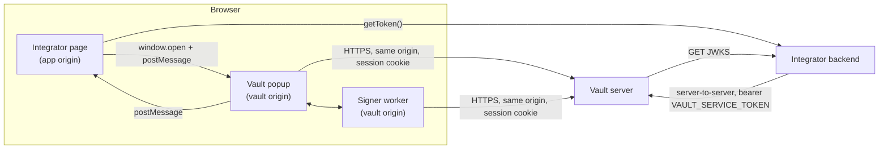
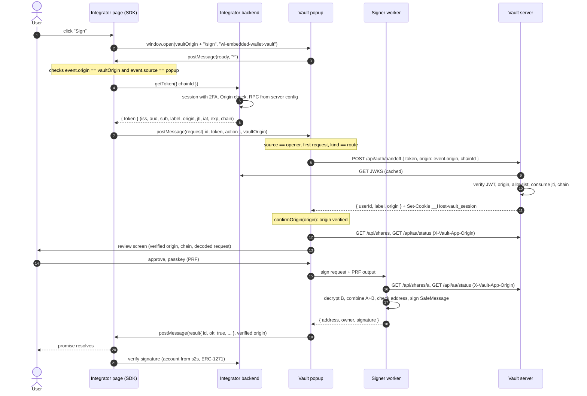
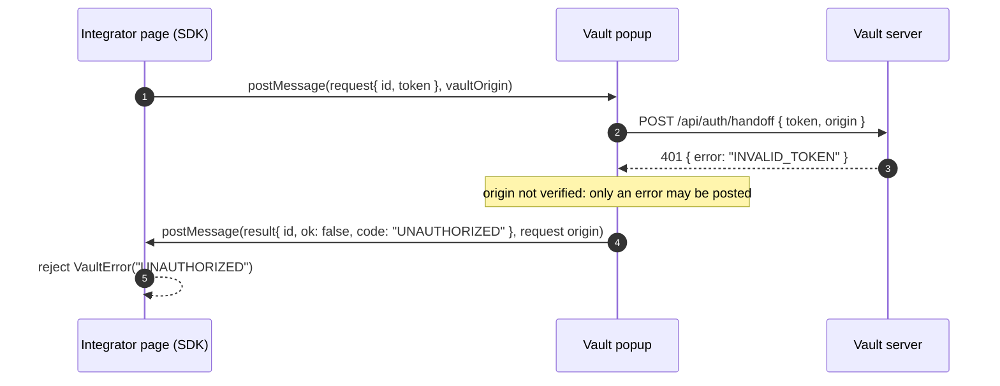

# App-vault protocol

This document specifies how an integrator page and the vault popup talk to each other: the `postMessage` messages, the actions, the origin checks on both sides, the popup lifecycle, the handoff token and its validation, and how the vault turns a token into a session. It describes version `wl-embedded-wallet/protocol/v1` as implemented in 0.1.0.

How to use it from an application is in [docs/INTEGRATION.md](INTEGRATION.md). The HTTP routes are specified in [docs/HTTP-API.md](HTTP-API.md). Related: [docs/ARCHITECTURE.md](ARCHITECTURE.md), [docs/THREAT-MODEL.md](THREAT-MODEL.md), [docs/CRYPTO-SPEC.md](CRYPTO-SPEC.md), [SECURITY.md](../SECURITY.md).

Sources of truth:

| Concern | File |
|---|---|
| Message types and constants | `packages/sdk/src/protocol.ts` |
| App side (SDK) | `packages/sdk/src/client/index.ts` |
| Vault side, channel | `apps/vault/lib/vault-channel.ts` |
| Vault side, token redemption and session header | `apps/vault/app/_components/vault-gate.tsx`, `apps/vault/lib/vault-api.ts` |
| Token verification | `apps/vault/server/handoff.ts`, `apps/vault/server/jwks.ts` |
| Redemption route and session | `apps/vault/app/api/auth/handoff/route.ts`, `apps/vault/server/http.ts` |
| Configuration | `apps/vault/server/config.ts` |
| Token minting (integrator side) | `packages/sdk/src/server/handoff.ts`, `packages/sdk/src/server/signer.ts` |

## Participants



- The **integrator page** runs the SDK (`@wl-embedded-wallet/sdk/client`). It never handles shares or the seed.
- The **vault popup** is a Next.js page on the vault's own origin (`ORIGIN`). It cannot be framed (`frame-ancestors 'none'`, `X-Frame-Options: DENY`), so a popup is the only way to reach it.
- The **integrator backend** authenticates the user and mints the handoff token. It publishes its public keys in a JWKS document that the vault server fetches.
- The **vault server** verifies tokens, holds share A and the encrypted envelopes, and proxies the bundler and paymaster for deployments.

## Constants

| Name | Value | Where |
|---|---|---|
| `VAULT_PROTOCOL` | `'wl-embedded-wallet/protocol/v1'` | Every message carries it in `protocol` |
| `VAULT_WINDOW_NAME` | `'wl-embedded-wallet-vault'` | The popup's window name; fixed, so the same window is reused |
| Popup features | `'popup,width=480,height=760'` | SDK |
| Closed-popup poll | 500 ms | SDK |
| Operation timeout | none by default; `timeoutMs` (1 to 2147483647 ms) | SDK |
| Handoff token lifetime (SDK minting) | 60 s (`HANDOFF_TTL_SECONDS`) | SDK server |
| Handoff token maximum lifetime (vault) | 120 s | Vault |
| Maximum `iat` in the future (vault) | 30 s | Vault |
| Session lifetime | 15 min, absolute | Vault |
| Session cookie | `__Host-vault_session` | Vault |
| Session binding header | `X-Vault-App-Origin` | Vault |

## Messages

There are three messages. All are plain objects sent with `postMessage` (structured clone), and all carry `protocol: 'wl-embedded-wallet/protocol/v1'`. A receiver ignores any message whose `protocol` differs.

```ts
type VaultReady = { protocol: typeof VAULT_PROTOCOL; type: 'ready' };

type VaultRequest = {
  protocol: typeof VAULT_PROTOCOL;
  type: 'request';
  id: string;
  token: string;
  action: VaultAction;
};

type VaultResult = {
  protocol: typeof VAULT_PROTOCOL;
  type: 'result';
  id: string;
} & (
  | {
      ok: true;
      // The Safe, which is the user's account. `owner` is the Shamir-split key that controls it.
      address: `0x${string}`;
      owner: `0x${string}`;
      signature?: `0x${string}`;
      // For `userOperation`, the complete operation with its signature. It is not submitted on-chain.
      userOperation?: UserOperationJson;
      // `deploy` only. When absent, the Safe was already deployed and nothing was signed.
      userOpHash?: `0x${string}`;
      transactionHash?: `0x${string}`;
    }
  | { ok: false; code: string }
);
```

### `ready` (vault to app)

```json
{ "protocol": "wl-embedded-wallet/protocol/v1", "type": "ready" }
```

- Sent by the vault page to `window.opener` once when the page loads, and again whenever the page calls `renew()` (today only the `/recover` page does, when the user switches to a tab that needs a new session).
- Sent with target origin `'*'`, because the vault does not know the app's origin before it has verified a token. It carries no data.
- Meaning: "send me a request with a fresh token". Every `ready` needs a new token, because tokens are single-use.

### `request` (app to vault)

```json
{
  "protocol": "wl-embedded-wallet/protocol/v1",
  "type": "request",
  "id": "4f0c2a8e-4a1b-4b55-9d0e-2f1f6d9b2c11",
  "token": "<handoff JWT>",
  "action": { "kind": "sign", "chain": { "chainId": 11155111 }, "request": { "kind": "message", "message": "Sign in to Example App" } }
}
```

- `id`: generated once per operation with `crypto.randomUUID()`. All requests of one operation (one per `ready`) share it, and the result echoes it.
- `token`: a fresh handoff token, obtained from `getToken(chain)` after the `ready` arrived. The token is never put in the URL.
- `action`: see [Actions](#actions).
- Posted by the SDK with `popup.postMessage(request, vaultOrigin)`: the browser delivers it only if the popup is on the vault's origin.
- The vault accepts it only if `protocol`, `type === 'request'`, a string `id`, a string `token` and an object `action` are present.

### `result` (vault to app)

```json
{ "protocol": "wl-embedded-wallet/protocol/v1", "type": "result", "id": "4f0c2a8e-4a1b-4b55-9d0e-2f1f6d9b2c11", "ok": true, "address": "0x...", "owner": "0x...", "signature": "0x..." }
```

```json
{ "protocol": "wl-embedded-wallet/protocol/v1", "type": "result", "id": "4f0c2a8e-4a1b-4b55-9d0e-2f1f6d9b2c11", "ok": false, "code": "USER_REJECTED" }
```

- Posted to `window.opener` with the exact origin of the accepted request as target origin.
- A result with `ok: true` is posted only after the vault server has verified the token and confirmed that its `origin` claim equals that request origin. Before that, only `ok: false` results can be posted; an `ok: true` outcome is replaced with `{ ok: false, code: 'UNAUTHORIZED' }`.
- At most one result per page load. After it, the page ignores further `respond` calls and `renew()`.
- The SDK handles a result only if its `id` matches the operation; results with another `id` are ignored. A result for the operation is then validated against the action, and settles the operation either way, since the vault posts at most one:
  - `ok === true` with the fields its action defines ([Actions](#actions)): `address` and `owner` 20-byte hex addresses; for `deploy`, both `userOpHash` and `transactionHash` as 32-byte hex, or neither; for `sign`, a non-empty even-length hex `signature`; for a `userOperation` request, also a complete `UserOperationJson` (quantities as decimal strings, addresses, hex data, `null` where allowed) whose `sender` equals `address` (ignoring case) and whose `signature` equals the result's. Any other field (for example a seed, if a vault ever sent one) is dropped. It resolves with the validated fields.
  - `ok === false` with a non-empty string `code`, which becomes `VaultError(code)`.
  - Anything else (a malformed `ok: true`, `ok: false` without a code, `ok` missing) rejects at once with `PROTOCOL_ERROR`. The exact per-action rules are in [docs/INTEGRATION.md](INTEGRATION.md#errors).

## Actions

`VaultAction['kind']` is also the popup route: the SDK opens `{vaultOrigin}/{kind}`. A page answers `INVALID_REQUEST` to a request whose `action.kind` is not its own route, and then stops.

| `kind` | Route | Action fields | Token `chain` | Result fields (`ok: true`) | SDK method |
|---|---|---|---|---|---|
| `activate` | `/activate` | none | must be absent | `address`, `owner` | `activate()` |
| `deploy` | `/deploy` | `chain: { chainId }` | required, same `chainId` | `address`, `owner`, and `userOpHash` + `transactionHash` if a deployment was sent | `deploy(chain)` |
| `sign` | `/sign` | `chain: { chainId }`, `request: VaultSignRequest` | required, same `chainId` | `address`, `owner`, `signature`, and `userOperation` for `request.kind === 'userOperation'` | `signMessage`, `signTypedData`, `signUserOperation` |
| `unlock` | `/unlock` | none | must be absent | `address`, `owner` | `unlock()` |
| `recover` | `/recover` | none | must be absent | `address`, `owner` | `recover()` |
| `export` | `/export` | none | must be absent | `address`, `owner` (the seed never leaves the vault) | `export()` |
| `relink` | `/relink` | none | must be absent | `address`, `owner` | `relink()` |

```ts
type VaultAction =
  | { kind: 'activate' }
  | { kind: 'deploy'; chain: { chainId: number } }
  | { kind: 'sign'; chain: { chainId: number }; request: VaultSignRequest }
  | { kind: 'unlock' }
  | { kind: 'recover' }
  | { kind: 'export' }
  | { kind: 'relink' };

type VaultSignRequest =
  | { kind: 'message'; message: string }
  | { kind: 'typedData'; typedData: TypedDataRequest }
  | { kind: 'userOperation'; userOperation: UserOperationRequest };
```

Notes:

- The action carries only `chainId`. The SDK passes the full `VaultChain` (`{ chainId, rpcUrl? }`) to `getToken`, never to the popup. The RPC, if any, travels only inside the token signed by the integrator backend.
- "Token `chain`" is enforced by the redemption route: the popup sends `chainId` only for `deploy` and `sign`, and the server requires `body.chainId ?? null` to equal `claims.chain?.chainId ?? null` (`CHAIN_REQUEST_MISMATCH` otherwise).
- After redemption, `deploy` and `sign` also check that the chain status the server computed (for the session's chain) has the action's `chainId` (`CHAIN_REQUEST_MISMATCH`).
- `sign` validates `request` with `parseSignRequest` (`packages/core/src/sign-request.ts`) before showing anything. The limits are listed in [docs/INTEGRATION.md](INTEGRATION.md#methods). An invalid request is answered with `INVALID_REQUEST`.
- `sign` refuses to sign on a chain where the Safe is not deployed (`WALLET_NOT_DEPLOYED`). `deploy` on an already deployed Safe answers immediately, without signing and without hashes.
- `activate` on an account that already has a wallet returns it; it never creates a second one. `relink` on an account that has one answers `WALLET_ALREADY_EXISTS`.
- Error codes are listed in [docs/INTEGRATION.md](INTEGRATION.md#errors).

## Origin checks

### App side (SDK)

- `vaultOrigin` is normalized with `new URL(vaultOrigin).origin`.
- The SDK handles a `message` event only if `event.origin === vaultOrigin` **and** `event.source` is the `WindowProxy` returned by its own `window.open`. Messages from other origins, or from another window on the vault origin, are ignored.
- Requests are posted with `targetOrigin = vaultOrigin`, so a token is never delivered to a popup that has navigated elsewhere.

### Vault page

- It listens only to messages whose `event.source` is `window.opener`, and ignores `event.origin === 'null'` (an opaque origin can be neither verified nor used as a target).
- It accepts only the first valid request per page load (or per `renew()`); later requests are ignored.
- It records `event.origin` as the **request origin**. This is the browser's statement of who sent the request, not yet trusted.
- It redeems the token with that request origin ([Session establishment](#session-establishment)). The server compares it with the token's `origin` claim and answers with the verified origin, which the page compares again with the request origin (`confirmOrigin`). Only then does the page consider the origin verified, show it on the review screen as "Requested by", and allow `ok: true` results.
- Results always go to the request origin, never to `'*'`.
- Without `window.opener`, the page shows "Open this window from the app" and does nothing. The offline recovery tabs of `/recover` still work without an opener.

### Vault server

- Every write route requires the `Origin` header to equal the vault's `ORIGIN` (`FORBIDDEN_ORIGIN`, 403). Read routes accept a missing `Origin` (same-origin `GET`) but reject a foreign one.
- The redemption route checks the request origin reported by the page against the token's signed `origin`, both normalized (`ORIGIN_MISMATCH`, 403).
- If `ALLOWED_APP_ORIGINS` is set (comma-separated exact origins, each validated at startup), a token whose `origin` is not listed is rejected (`ORIGIN_NOT_ALLOWED`, 403). If it is not set, any origin that the integrator backend signs is accepted: **the signed `origin` claim is what authorizes an app**.
- Every route that requires a session also requires `X-Vault-App-Origin` to equal the origin bound to the session ([Session binding](#session-binding)).

## Popup lifecycle

1. **Open.** The SDK method runs synchronously up to `window.open('{vaultOrigin}/{kind}', 'wl-embedded-wallet-vault', 'popup,width=480,height=760')`, so it must be called from a user gesture. If `open` returns `null`, it rejects with `POPUP_BLOCKED`. If `open` throws, it rejects with `INTERNAL`. Otherwise it focuses the popup, generates `id`, starts polling `popup.closed` every 500 ms, starts the `timeoutMs` timer if one is configured, and registers its `message` listener.
2. **Ready.** The vault page loads and posts `ready` to its opener.
3. **Token.** For each `ready`, the SDK calls `getToken(chain)`. If several `ready` messages arrive while tokens are being fetched, only the most recent one is answered. If `getToken` fails, or returns anything other than a non-empty string, for the most recent `ready`, the operation rejects with `TOKEN_UNAVAILABLE` and nothing is sent; a failure for an older `ready` is ignored.
4. **Request.** The SDK posts `request` to the vault origin. If `postMessage` throws (for example, a request that cannot be cloned), it rejects with `INTERNAL`.
5. **Redemption.** The page sends the token, the request origin and (for `deploy` and `sign`) the `chainId` to `POST /api/auth/handoff`, which verifies the token, consumes its `jti`, and sets the session cookie. On failure, the page posts `{ ok: false, code }` and shows the error.
6. **Flow.** The page runs the action. Signing operations show a review screen and need the user's approval and passkey. Share A is fetched by the signer worker through the session, the seed is rebuilt in the worker for this operation only, and only the outcome comes back to the page.
7. **Result.** The page posts one `result`. The SDK validates it, removes its listener, stops polling, clears the timeout and settles the promise (`PROTOCOL_ERROR` if the result is malformed).
8. **Close.** The SDK does not close the popup, except on `TIMEOUT`. The vault shows a final screen whose "Back to the app" button focuses the opener and calls `window.close()`. The user may also close it at any time.

Other rules:

- **One operation per page load.** A vault page accepts one request and posts one result. The `/recover` page is the only exception: switching to a tab that opens a session calls `renew()`, which clears the accepted request and posts a new `ready`; the SDK answers with a new token and the same `id`.
- **User closes the popup** before a result: the SDK's poll sees `popup.closed` and rejects with `POPUP_CLOSED`. This holds at every stage: before the first `ready`, while `getToken` is pending (the token it returns afterwards is never sent) and after the request was sent. Anything already done on the server side (for example a completed activation or deployment) is not rolled back.
- **New operation while one is pending:** the window name is fixed, so `window.open` navigates the same popup to the new route. Before that, the SDK rejects the pending operation with `SUPERSEDED` and removes its listener, so it cannot answer the new page's `ready`. This holds across `VaultClient` instances on the same `window`.
- **Timeouts.** By default the SDK has none: an operation waits for a result, `POPUP_CLOSED` or `SUPERSEDED`. With `timeoutMs`, an operation that has not settled that many milliseconds after `window.open` rejects with `TIMEOUT`, whatever its stage (including a flow waiting for the user to retry); the SDK removes its listener, clears its timers and calls `popup.close()`, which a page may do on a popup it opened. A `timeoutMs` that is not a positive finite number of at most 2147483647 makes `createVaultClient` throw `RangeError('INVALID_TIMEOUT')`. A token must be redeemed within its lifetime (60 s as minted by the SDK); since it is fetched on `ready` and redeemed immediately, this is normally not an issue. The vault session lasts 15 minutes from redemption. A passkey prompt times out after 60 s inside the vault (`CANCELLED`); in the signing and deployment flows a cancelled passkey is not final, and the user can retry or reject.
- **Non-final errors.** Some flows show an error in the popup and let the user retry instead of posting it (a cancelled passkey while deploying or relinking, any exception while approving a signature, such as a cancelled passkey, and a wrong kit or code in the `/relink` recovery forms). In those cases the app's promise stays pending until a later success, rejection, `POPUP_CLOSED` or `TIMEOUT` (with `timeoutMs`).

### Typical operation: `signMessage`



### Failure: token rejected



## Handoff token

A compact JWS (JWT) minted by the integrator backend for one operation. It tells the vault who the user is (`sub`), which app is asking (`origin`) and, optionally, which chain to use.

### Header

| Field | Rule |
|---|---|
| `alg` | With `HANDOFF_JWKS_URL`: one of `EdDSA`, `ES256`, `RS256`. With `HANDOFF_PUBLIC_KEY`: `EdDSA` only. Anything else (for example `HS256`, `PS256`, `ES384`, `none`) is rejected, as `BAD_ALGORITHM` or `MALFORMED` depending on how `jose` classifies it; either way the browser only sees `INVALID_TOKEN` |
| `kid` | Required with `HANDOFF_JWKS_URL`, even if the JWKS holds one key: a token without `kid` is rejected (`UNKNOWN_KEY`). Ignored with `HANDOFF_PUBLIC_KEY` |
| `typ` | The SDK sets `JWT` (`createHandoffToken`, `HandoffSigner.mint`). The vault does not check it |

The vault verifies with `jose`'s `jwtVerify`. `jose` selects the JWK by `kid` and by compatibility with `alg`. Whether `jose` 6 would also accept an Ed448 key under `EdDSA` has not been verified; the SDK only produces Ed25519 keys.

### Claims and validation

`verifyHandoffToken` (`apps/vault/server/handoff.ts`), in order:

1. Signature, with the algorithm allowlist above.
2. `iss` must equal `HANDOFF_ISSUER` exactly (`BAD_ISSUER`).
3. `aud` must equal `HANDOFF_AUDIENCE`, or the vault's `ORIGIN` if that is unset (`BAD_AUDIENCE`).
4. `iss`, `aud`, `sub`, `jti`, `iat` and `exp` must be present; `exp` must not have passed (`EXPIRED`); a `nbf`, if present, must have passed. No clock tolerance is applied to `exp`.
5. Then (`MALFORMED` on any failure):
   - `sub` is a string matching `^[A-Za-z0-9_-]{1,64}$` (it ends up `|`-separated in the envelopes' AAD);
   - `jti` is a string matching the same pattern;
   - `label` is a string of at most 256 UTF-16 code units with no control characters (`\p{Cc}`);
   - `iat` and `exp` are integers;
   - `chain`, if present, is an object with `chainId` a safe integer greater than 0 and `rpcUrl` either absent or a string of at most 2048 characters;
   - `origin` normalizes to an origin: `http:` or `https:`, `https` required except for local hosts (`localhost`, `127.0.0.1`, `[::1]`, `*.localhost`) outside production or with `ALLOW_INSECURE_LOCAL=1`, and no path (other than `/`), query, fragment or credentials;
   - `iat <= now + 30`, `exp - iat <= 120` and `exp - now <= 120`.

`checkHandoffRequest`, called by the redemption route, then runs every remaining check without spending anything:

6. Compares the normalized request origin with the claim's `origin` (`ORIGIN_MISMATCH`).
7. If `ALLOWED_APP_ORIGINS` is set, requires the claim's `origin` to be listed (`ORIGIN_NOT_ALLOWED`).
8. Requires the request's `chainId` to equal the claim's `chain.chainId`, both absent counting as equal (`CHAIN_REQUEST_MISMATCH`).

The route then applies the per-`sub` rate limit (`429 RATE_LIMITED`), and only then `spendHandoffToken` consumes the `jti` atomically (`REPLAYED` if already used). **No rejection spends the `jti`**: a token refused in any earlier step, including a chain mismatch or a rate limit, can still be redeemed once with a correct request before it expires.

Any other error during verification (for example the JWKS cannot be fetched and no usable cache exists) maps to `KEYS_UNAVAILABLE`.

`HandoffError` messages contain only the reason, never token data.

### Single use

`consumeJti(jti, exp)` inserts the `jti` into the `used_jti` table with its expiry, in one statement (`INSERT ... ON CONFLICT (jti) DO UPDATE ... WHERE used_jti.expires_at <= now`). Of several concurrent redemptions of the same `jti`, only one succeeds. Rows whose expiry has passed are deleted on the next consumption, and a `jti` can be reused only after the token that first used it has expired. The namespace is global: `jti` values are not scoped by issuer or `sub`.

### Redemption errors as seen by each party

| Vault reason | HTTP answer of `POST /api/auth/handoff` | Code the popup posts to the app |
|---|---|---|
| Missing `token` in the body | `401 INVALID_TOKEN` | `UNAUTHORIZED` |
| `MALFORMED`, `BAD_SIGNATURE`, `BAD_ALGORITHM`, `BAD_ISSUER`, `BAD_AUDIENCE`, `EXPIRED`, `REPLAYED`, `UNKNOWN_KEY`, `KEYS_UNAVAILABLE` | `401 INVALID_TOKEN` | `UNAUTHORIZED` |
| `ORIGIN_MISMATCH` | `403 ORIGIN_MISMATCH` | `ORIGIN_MISMATCH` |
| `ORIGIN_NOT_ALLOWED` | `403 ORIGIN_NOT_ALLOWED` | `ORIGIN_NOT_ALLOWED` |
| Chain mismatch | `400 CHAIN_REQUEST_MISMATCH` | `CHAIN_REQUEST_MISMATCH` |
| Wrong `Origin` header on the request | `403 FORBIDDEN_ORIGIN` | `UNAUTHORIZED` |
| Vault server unreachable | none | `NETWORK` |

The specific failure reason is deliberately not disclosed to the browser.

### Minting

The SDK mints tokens in two ways, both with `exp = iat + 60`, a random `jti` and the same input checks (`sub` pattern; non-empty `iss`, `aud`, `origin`):

- `createHandoffToken(input, privateKeyHex)`: Ed25519 in hex, header `{ alg: 'EdDSA', typ: 'JWT', kid? }`, `jti` = 16 random bytes in base64url.
- `HandoffSigner.mint(input)` (`createHandoffSigner`, `generateHandoffSigner`): `EdDSA`, `ES256` or `RS256` through `jose`, header `{ alg, kid, typ: 'JWT' }`.

Any other JWT library works if it produces the claims above. See [docs/INTEGRATION.md](INTEGRATION.md#4-your-backend-the-handoff-token).

## JWKS fetching and caching

With `HANDOFF_JWKS_URL`, keys come from `createRemoteJWKSet` (`jose`) with a custom download (`apps/vault/server/jwks.ts`). The key source is kept on `globalThis` and shared by all routes of a server process; it is rebuilt if the URL or the timing options change. Each replica has its own cache.

| Parameter | Variable | Default | Effect |
|---|---|---|---|
| Cache age | `HANDOFF_JWKS_CACHE_SECONDS` | 300 s | After this, the next verification refreshes the document even if the keys are still valid |
| Cooldown | `HANDOFF_JWKS_COOLDOWN_SECONDS` | 30 s | Minimum time between refreshes triggered by an unknown `kid`, and between download attempts after a failure |
| Maximum staleness | `HANDOFF_JWKS_MAX_STALE_SECONDS` | 3600 s | While downloads fail, the last good document stays usable for this long after it was fetched; after that, tokens are rejected |
| Timeout | none | 5 s | Per download |
| Maximum size | none | 64 KiB | Checked against `Content-Length` and while streaming |

The variables must be positive integers; anything else is a startup configuration error.

Download rules:

- `redirect: 'manual'` and `cache: 'no-store'`. Only status `200` is accepted, so a redirect is rejected without being followed.
- The body must be JSON with a `keys` array of objects.
- If any key has a private member (`d`, `p`, `q`, `dp`, `dq`, `qi`, `oth`, `k`) or `kty: 'oct'`, the document is rejected **and the last good copy is discarded**: the vault fails closed until a clean document is served.
- After a failure, attempts within the cooldown do not hit the network: they return the last good copy if it is within the staleness limit, or fail.
- Failures are logged with their cause only (for example `HTTP 404`, `timed out`, `document too large`), never with the URL or the document.

Behavior for an unknown `kid`: `jose` refreshes the document (subject to the cooldown) and retries; if the `kid` is still missing, the token is rejected (`UNKNOWN_KEY`). A rotation procedure is in [docs/INTEGRATION.md](INTEGRATION.md#rotating-the-key).

### Static key mode

With `HANDOFF_PUBLIC_KEY` (a 32-byte Ed25519 public key in hex, validated as a curve point at startup) instead of a JWKS, the vault verifies every token against that single key, accepts only `EdDSA`, and ignores `kid`. Exactly one of `HANDOFF_JWKS_URL` and `HANDOFF_PUBLIC_KEY` must be set. Rotating the key requires a configuration change.

## Session establishment

### Redemption request

The vault page calls, on its own origin:

```http
POST /api/auth/handoff
Origin: <vault ORIGIN>
Content-Type: application/json

{ "token": "<handoff JWT>", "origin": "<event.origin of the request>", "chainId": 11155111 }
```

`chainId` is sent only for `deploy` and `sign`. On success:

```http
HTTP/1.1 200 OK
Cache-Control: no-store
Set-Cookie: __Host-vault_session=<token>; Path=/; Max-Age=900; Secure; HttpOnly; SameSite=Strict

{ "userId": "<sub>", "label": "<label>", "origin": "<verified app origin>" }
```

On success the server:

1. upserts the user (`sub`, `label`);
2. deletes the session currently identified by this browser's cookie, if any, so a session never carries over to another `sub` or app;
3. creates a new session: a 32-byte random token (base64url), bound to `sub`, to the token's `origin` (the session's **app origin**) and to the token's `chain` (`chainId` and `rpcUrl`, or none);
4. sets the cookie.

Cookie attributes: name `__Host-vault_session`, `HttpOnly`, `Secure`, `SameSite=Strict`, `Path=/`, no `Domain`, `Max-Age` 900 seconds. The session expires 15 minutes after creation; it is not extended by use. Expired sessions are deleted when a new one is created. Each operation redeems its own token and therefore gets its own session.

### Session binding

After redemption, the page stores the verified app origin in memory, and every later call to the vault API from the page or the signer worker carries:

```http
X-Vault-App-Origin: <verified app origin>
```

`requireSession` (`apps/vault/server/http.ts`) answers `401 UNAUTHORIZED` without a valid session, and `403 ORIGIN_MISMATCH` if the session has no app origin or the header differs from it. The routes that require a session are `GET`/`POST`/`PATCH /api/shares`, `GET /api/shares/a`, `POST /api/shares/exported`, `GET /api/aa/status`, `POST /api/aa/rpc`, `POST /api/webauthn/challenge`, `POST /api/relink/nonce` and `POST /api/relink`. The passkey recovery routes (`/api/recovery/passkey/*`) work without a session.

The header is set by the vault's own code, not by the integrator. It ties a vault page to the session it redeemed: a page that verified app A cannot act on a session created for app B in the same browser (for example after another popup replaced the cookie). It is not a defense against code running on the vault origin itself.

The session's chain decides which network `GET /api/aa/status` and the bundler proxy use. The RPC is resolved as follows: an `rpcUrl` for that chain in `AA_CHAINS` takes precedence; otherwise the token's `rpcUrl` is used only if it is `https` (or `http` on a local host), has no credentials, and its host is in `RPC_ALLOWED_HOSTS`; otherwise `CHAIN_NOT_SUPPORTED`.

## Several apps

- One vault has exactly one `HANDOFF_ISSUER` and one key source. Apps that share the wallet share the login: same issuer, same JWKS, same `sub` for the same user, and therefore the same Safe.
- Each app is identified by the `origin` claim of the tokens minted for it, and each session is bound to that origin. Two apps on different origins get different sessions, and every result is posted only to the origin that requested it.
- `ALLOWED_APP_ORIGINS` optionally restricts which origins the vault accepts.
- Passkeys are bound to the vault's host (`RP_ID`, which must equal the host of `ORIGIN`), so they work from every app.
- A login backend shared by several apps must choose `origin` from its own list, never by reflecting the caller's `Origin` header unchecked. See [docs/INTEGRATION.md](INTEGRATION.md#8-several-apps-one-wallet).

## Security properties and limits

- The only secret that crosses `postMessage` is the handoff token, always posted to the exact vault origin. Shares, envelopes and the seed never cross it. `ready` is the only message sent with `'*'`, and it carries nothing.
- The token authorizes a session for one `sub`, one app origin and optionally one chain. Whoever obtains a live, unredeemed token can redeem it outside a browser (the `Origin` header and the reported `origin` can both be forged by a non-browser client) and obtain a session, and with it that user's share A. Share A alone does not rebuild the seed. See [docs/THREAT-MODEL.md](THREAT-MODEL.md).
- The `origin` check proves which page sent a request only for requests delivered by a browser. It is what prevents a third-party website from using a token minted for another app.
- The vault does not verify that the user passed a second factor: it trusts the integrator's signature.
- A compromised integrator page can request any operation the protocol offers. The vault's review screen, which shows the verified origin, the chain and the decoded request, is the last barrier for signatures.

## Server-to-server API

The integrator backend reads public wallet data directly from the vault server, outside the popup protocol:

- `GET /api/s2s/accounts/{sub}`, with `Authorization: Bearer <VAULT_SERVICE_TOKEN>` (compared in constant time; at least 32 characters): `{ exists, address, owner }`, plus `chainId`, `deployed`, `deployable`, `sponsored` or `chainError` with `?chainId=` (and optionally `&rpcUrl=`). `401 UNAUTHORIZED` without a valid token.
- `GET /api/health`: no authentication.

`createVaultServiceClient` in `@wl-embedded-wallet/sdk/server` wraps the account route. Request and response details are in [docs/HTTP-API.md](HTTP-API.md) and [docs/INTEGRATION.md](INTEGRATION.md#7-server-to-server-api).

## Versioning

The protocol tag is checked for equality on both sides; there is no negotiation. A future incompatible version would use a new tag, and an SDK and a vault with different tags would ignore each other's messages (the operation would wait until the popup is closed or `timeoutMs` passed).
